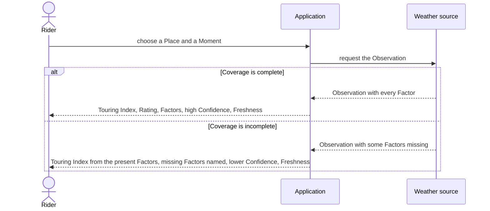
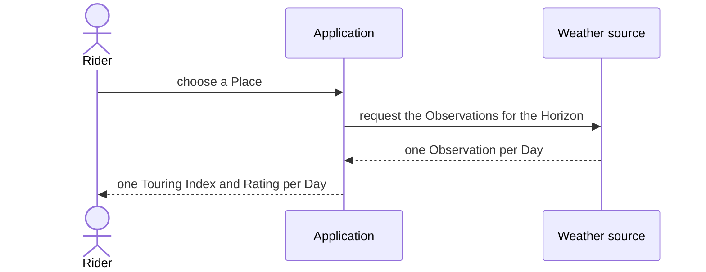

# Moto Weather Index

## Overview

Moto Weather Index tells a rider how comfortable a motorcycle ride will be at a chosen place and time in Japan. It obtains the forecast for that place from an external weather source, converts it into a Touring Index from 0 to 100, shows the factors behind the index, and extends the same judgement across the coming week.

It is one user-facing application and exposes no interface for other systems. It has no accounts and keeps no ride history: the forecast is the only source of truth, and an index exists only for the request that produces it.

## Domain Model

- **Place** — A location the rider selects, identified by latitude and longitude and shown with a name. The product covers places in Japan.
- **Moment** — A date and hour in Japan Standard Time.
- **Day** — A calendar date in Japan Standard Time.
- **Observation** — The weather for a Place at a Moment, or the weather aggregated across a Day. It provides eight Factors: weather condition, temperature, wind speed, humidity, visibility, precipitation probability, UV index, and air quality.
- **Factor** — One weather quantity of an Observation and the points it contributes to a Touring Index. Each Factor has a maximum contribution, and the eight maxima form the basis of 100.
- **Touring Index** — An integer from 0 to 100 for one Place at one Moment or on one Day. A higher index means a more comfortable ride.
- **Coverage** — The set of Factors an Observation provides.
- **Confidence** — The share of the basis that Coverage accounts for, presented as high, medium, or low.
- **Rating** — The label and colour a Touring Index receives, ordered 最高, 良好, 普通, 注意, 危険 from the highest index to the lowest.
- **Freshness** — The time at which the weather source returned the Observation behind an index.
- **Horizon** — The Days from today for which the product presents a Touring Index. The week view covers seven Days.

## Scenarios

### A rider decides whether to ride now

A rider wants to know how comfortable a ride would be at this moment, so reads the Touring Index for their Place and the current hour.

### A rider plans the coming week

A rider wants to know which Day of the coming week suits a ride, so reads the Touring Index for their Place on each Day of the Horizon.

## Invariants

- A missing Factor never suppresses a Touring Index: the product names the missing Factors and reports lower Confidence.
- An index with incomplete Coverage is never presented as complete.
- Touring Indices of different Confidence are not presented as directly comparable.
- Every presented index names its Place, its target Moment or Day, its Factors, its Rating, the weather source, and its Freshness.

## References

- [Serve the product as a single application with no public API](../adr/single-application.md)
- [Build the interface with Vite and React, and serve it with Hono](../adr/vite-react-spa.md)
- [Obtain forecasts and air quality from Open-Meteo](../adr/open-meteo.md)
- [Compute every index on request and keep no history](../adr/no-persistence.md)
- [Return an index with reduced confidence when a factor is missing](../adr/degraded-index.md)
